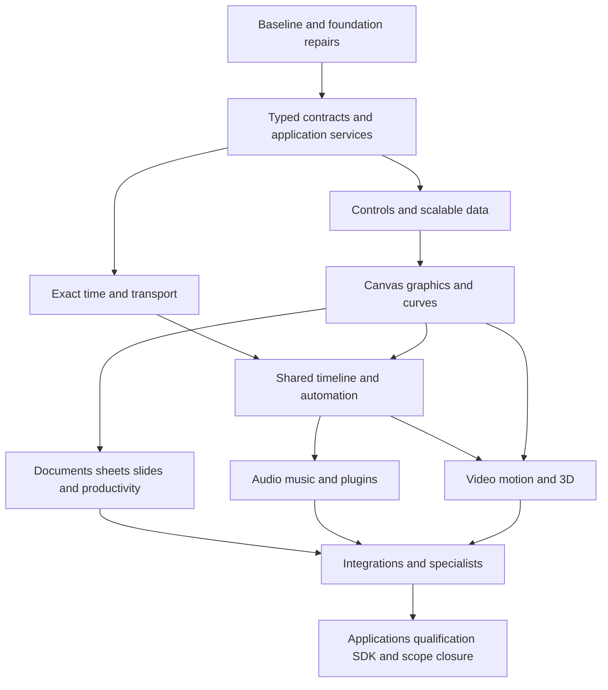

<!-- SPDX-License-Identifier: LGPL-3.0-or-later -->
# Complete implementation plan — Sol orchestration

**Planning handoff, 2026-09-22. No implementation or agent orchestration has
started.** This extends the [audit and proposal book](../README.md) into an
executable program: **84 work packages, all 212 proposed additions, and 64
supporting obligations**. GPT 6 Sol is the sole orchestrator and integration
owner. GPT 6 Luna handles bounded implementation work. GPT 6 Astra is available
for specific hard problems and returns its result to Sol.

## Start here

1. Open this repository in a **GPT 6 Sol** session.
2. Give Sol the [handoff prompt](sol-handoff.md). It contains the execution
   instructions, model assignments, build policy and first actions.
3. Sol begins with [WP-001](phase-00-baseline.md#wp-001), verifies the live tree,
   initializes evidence and takes ownership of this plan. The current dirty tree
   is part of the audited baseline; starting from HEAD alone would omit work.

No CLI flags, persistent agent configuration or model switch have been applied
by this planning task. Model identifiers in the manifest describe the requested
roles; the executing session must actually provide those models and delegation.

## What completion means

All named proposals, including P2 and P3, are mandatory for this program. Every
one must satisfy its original purpose, contract and completion check, the owning
package steps, and the [common acceptance gate](acceptance.md). A component may
be a service, adapter or shared implementation; 212 names do not require 212
independent engines or 212 separately constructible QML types.

Completion also includes the nine audit findings, ten existing-foundation
improvement rows, documentation drift, 25 engine/integration obligations, 14
visualization families and five final qualification obligations. Conditional
foundation investigations retain their original implement-or-document decision
boundary; mandatory named proposals cannot be closed by a deferral decision.

The delivered result is a broad reusable application framework with functional
domain packs, real reference backends, runnable applications and explicit format
and platform capabilities. “Any app” remains an extensibility objective. This
plan does not promise an exhaustive clone of every Adobe, Microsoft, Avid or
Apple application, every proprietary file format, or every future app category.

The earlier [roadmap](../roadmap.md) recommends selecting one pilot and treats
advanced domains as optional. **For this requested full-scope execution, the
coverage and dependencies here supersede that reduced delivery scope.** Vertical
slices are intermediate proofs; work continues through the complete ledger.

## Plan map

| Document | Use |
| --- | --- |
| [Sol handoff](sol-handoff.md) | Paste into the future Sol execution session |
| [Orchestration rules](orchestration.md) | Roles, task routing, isolated work, efficiency and build policy |
| [Task and evidence templates](task-templates.md) | Exact worker packet, return format and Astra consultation |
| [Proposal coverage](proposal-coverage.md) | All 212 IDs assigned once to their primary implementation package |
| [Supporting scope](supporting-scope.md) | Findings, foundation changes, engines, visualization families and qualification |
| [Backend execution strategy](backends.md) | How to choose, implement and qualify actual domain providers |
| [Acceptance and verification](acceptance.md) | Per-package gates, complete workflow proofs and final completion rules |
| [Execution ledger](execution-ledger.md) | Mutable package state and evidence links; initially all planned |
| [Machine-readable plan](plan.json) | Package IDs, roles, dependencies, scope and status |
| [Planning verification](verification.md) | Checks performed on this plan, distinct from future runtime tests |

## Step 1 — establish an accurate, repairable baseline

Execute [phase 00](phase-00-baseline.md), packages WP-001–007. Capture user changes
and environment before any branch/worktree creation. Reproduce audit risks,
repair confirmed defects, improve catalog coverage, isolate private Qt exposure
and settle layout/theme/control contracts. Preserve compatible current behavior.

**Gate M0:** source findings are dispositioned, existing regressions are known,
the declared Qt baseline has evidence, and foundation changes have geometry,
pixel and interaction checks. F09's persistence decision finishes in WP-014.

## Step 2 — create the common application framework

Execute [phase 01](phase-01-services.md), WP-010–019. Sol fixes the shared
interfaces first: identity/revisions, commands/focus, transactions/selection,
documents/recovery, settings/workspaces, jobs/assets, transfer, accessibility,
native windows and format operations. Document the dependency boundaries before
Luna implements consumers. Begin exact-time work WP-046 once its dependencies
are accepted; it need not wait for every control.

**Gate M1:** a real two-document app can issue the same operation from multiple
input paths, cancel/undo an edit, survive a failed save and reject stale jobs.

## Step 3 — build common controls and scalable views

Execute [phase 02](phase-02-controls-data.md), WP-020–033. Luna implements
bounded control families from settled contracts. Sol owns virtualization,
range editing, query/statistical/render algorithms and integration. Prove the
shared workbench before replicating these patterns into domain packs.

**Gate M2:** real data can be edited, transferred, filtered, plotted, saved and
recovered with bounded delegates and meaningful accessibility. Chart families
with domain engines complete in their later specialist packages.

## Step 4 — build the reusable authoring surfaces

Execute [phase 03](phase-03-authoring.md), WP-040–049. Build spatial rendering,
tools, snapping, selection, transforms, layers, color, vector/raster editing,
exact time, transport, timelines and automation. Keep engine clocks and render
resource ownership out of QML. Preserve existing Viewport, Graph, Meter,
Waveform and DockFloating contracts.

**Gate M3:** actual graphics content supports edit/undo/persistence/output, and
the shared timeline preserves exact positions with bounded visible items. A test
transport clock is useful here; actual audio/video engines remain required.

## Step 5 — finish every Office and document workflow

Execute [phase 04](phase-04-office.md), WP-050–059. Build functional text layout,
pagination, workbook calculation, slide evaluation, PDF annotation and local
productivity/database providers. Sol proves each hard backend operation before
assigning dependent UI work to Luna. Reuse the shared canvas, grid and timeline.

**Gate M4:** documents, sheets, slides, PDF, notebooks, mail/calendar/tasks and
database forms/reports each have a persistent, functional reference workflow.

## Step 6 — finish audio and music

Execute [phase 05](phase-05-audio.md), WP-060–068. Integrate actual audio I/O,
offline rendering, calibrated meters, mixing/routing, spectral processing,
MIDI/sequencing, comping, plugins, notation and pitch processing.

**Gate M5:** audio is recorded/imported, edited, automated, mixed and rendered;
musical data and advanced editors operate on real providers. Realtime behavior
has separate evidence from GUI performance. No spoken updates or unattended
playback are used; audible hardware/listening tests follow the user's audio
instructions and require explicit interactive authorization when applicable.

## Step 7 — finish video, motion and 3D

Execute [phase 06](phase-06-video.md), WP-070–078. Implement real decode/output,
frame-exact edits, multicam/transitions, captions/scopes/grading, keyframes,
composition, node evaluation, tracking/roto, 3D, rigs, UV/texture work and durable
render queues. Share exact time and color across these packs.

**Gate M6:** output frames/audio reflect actual authored sequence/composition
state, and the advanced scene/processing editors survive undo and persistence.

## Step 8 — complete integrations and specialist applications

Execute [phase 07](phase-07-integrations.md), WP-080–089. Finish native detached
panels, extensions/scripting, code/terminal, collaboration, diagrams/CAD, maps,
science/volumes, asset dependencies and traces. Qualify backend and format
boundaries using actual environments and fixture corpora.

**Gate M7:** every proposed feature exists with its advertised behavior, and
each optional integration has explicit, evidence-backed capabilities.

## Step 9 — qualify and deliver the complete SDK

Execute [phase 08](phase-08-qualification.md), WP-090–094. Finish representative
applications, scale/failure measurements, assistive/localized/input workflows,
clean installed consumers, packaging, documentation and final coverage audit.

**Gate M8:** all mandatory work is accepted and traceable to integrated source,
tests, runtime evidence and documentation. Deliver local artifacts and a truthful
support matrix. Unavailable required hardware/backend evidence keeps its claim
unqualified; it cannot be reported as a pass.

## Scheduling and critical dependencies

This is a summary. [plan.json](plan.json) gives the exact acyclic graph; it permits
independent work earlier than the drawing's broad phase groups. Sol selects ready
packages from the graph and keeps one principal backend problem active locally
while Luna completes independent controls, fixtures and documentation.

There is no invented calendar estimate. WP-001 establishes measured build/test
costs; Sol records actual package effort and revises forecasts after M1/M2.
Component counts alone cannot estimate engines, fidelity or hardware work.

## First execution cycle

1. Sol completes WP-001 and records the faithful integration snapshot.
2. Luna takes bounded F01–F03 tasks from WP-002 and convention/catalog tasks
   from WP-003/004, subject to available slots and file ownership.
   Keep Ruler fixes and token edits sequential; WP-004 or the independent
   KeyCap/Filmstrip work can run beside WP-002 without overlapping that file.
3. Sol works WP-005's private Qt/consumer boundary while those tasks are active.
4. Sol reviews results, reproduces meaningful evidence and integrates accepted
   changes; workers return complete files/commits and never merge themselves.
5. Sol completes WP-006/007, then publishes WP-010 contracts and proceeds through
   ready services. Begin Luna control work only after those dependencies settle.
6. Repeat the same bounded cycle through all packages. A milestone is an
   internal quality gate, not a recurring request for user permission.
