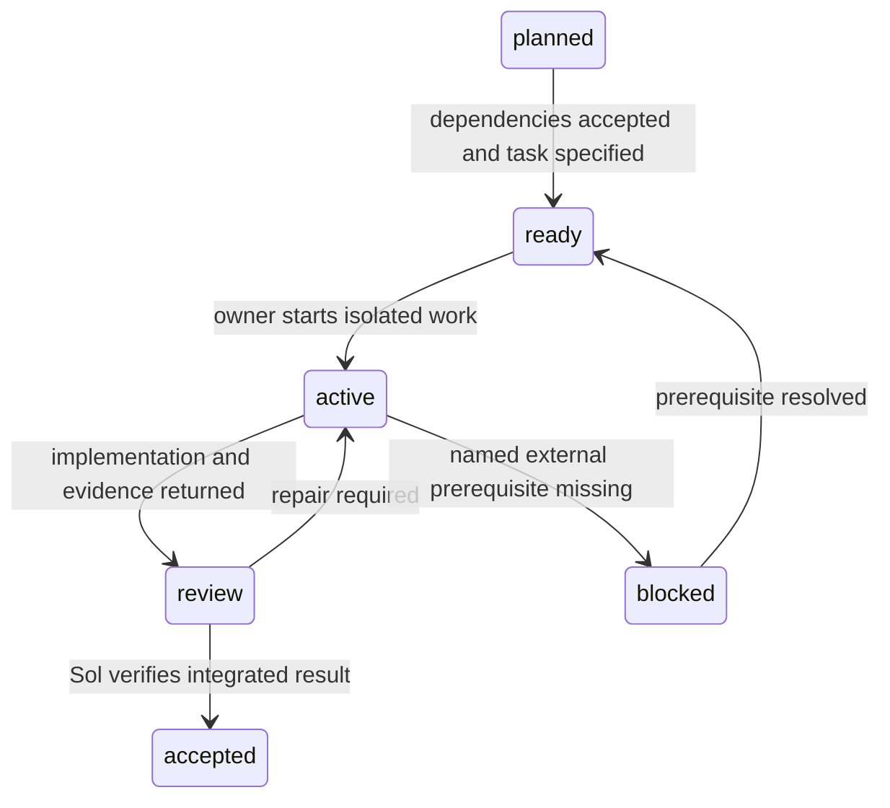

<!-- SPDX-License-Identifier: LGPL-3.0-or-later -->
# Implementation acceptance and verification

[Plan](README.md) · [Scope](proposal-coverage.md) · [Supporting obligations](supporting-scope.md)

**Future execution requirements. No runtime results are claimed on this page.**
Sol owns acceptance. Read each original proposal's purpose, contract, boundary
and completion check in addition to its package steps. Use evidence from the
integrated source that is actually being delivered.

## Package state machine

`blocked` is an execution-ledger state, not completion. Keep unrelated ready work
moving. A package that was accepted must be reopened if later changes invalidate
its contract or required evidence. Record the reason; preserve historical results.

## Common completion gate for every package

| Gate | Required evidence |
| --- | --- |
| Scope | Every assigned proposal/support ID has a disposition meeting its actual requirements; no silent omissions |
| Real behavior | Authoritative model/service/engine behavior is connected; mocks are labeled and do not replace required real paths |
| Public contract | Types, properties, signals, commands, ownership, errors and compatibility are documented; speculative signatures have been reconciled with implementation |
| Editing | Relevant commit/cancel/undo/redo, user/programmatic notifications, validation and read-only/mixed/default behavior work |
| Identity/lifecycle | Reset, deletion, recycling, close, stale results and lost input grabs do not target obsolete objects or leak resources |
| Interaction | Keyboard, focus, tooltip/name/role/actions, IME and appropriate assistive semantics are present and verified at the applicable level |
| Theme/layout | Tk naming, Templates, Theme roles, toolkit layouts, stable objectNames, density and large-text behavior conform |
| Verification | Meaningful focused tests plus required integration, numerical/output/device or runtime checks pass on the recorded environment |
| Visual claims | Actual geometry dumps and opened/inspected screenshots demonstrate changed layout/render behavior |
| Scale/failure | Relevant work/cache/delegate bounds, cancellation and error recovery are measured or exercised |
| Documentation | Operational docs, ADRs, examples and generated catalog match the implemented source |
| Integration | Sol reviews and accepts the merged result; required checks run against that result, not only a worker branch |

“Not applicable” must name why a gate does not apply. For example, a catalog
parser change does not need a screen-reader run; a custom editable canvas does.
Avoid tests that merely repeat implementation expressions. Prefer user-visible
state transitions, numerical answers, lifecycle failures and boundary cases.

## Verification sequence inside a package

1. Capture the relevant baseline or failing reproduction before changes.
2. Run the smallest meaningful check while implementing the behavior.
3. Run related model/interaction/provider checks and negative cases.
4. Reconfigure after adding QML, then build with the required actual job/load
   limits and run relevant ctest/qmllint gates.
5. Use qtk-preview for instantiation and geometry. For visual/layout changes,
   capture compact/comfortable and relevant theme/scale cases; open the images
   and inspect them. Include representative dump lines in the evidence record.
6. Run the package's real backend/output/device scenario where required.
7. After integration, run the impacted integration gate and required repository
   regression suite. Broaden testing only for a concrete remaining risk or gate.
8. Update docs/evidence/status together and move on once verification is adequate.

Commands come from the live repository instructions. Read
`portageq envvar MAKEOPTS` before deriving direct build backend job/load arguments;
never change the configured value or reduce limits for a worker. Use isolated
build directories. A missing environment is reported accurately, not converted
into a passing result.

Remember the repository's actual test/preview constraints: visible QML TestCases,
popup content/overlay handling, child Tk.ToolTip instances, direct-child clickable
field affordances, no `layer` ID, and layout-owned implicit sizes. These can
produce misleading results if the fixture violates the toolkit's own rules.

## Shared behavioral fixtures

| Concern | Required scenario |
| --- | --- |
| Commands/context | Menu, shortcut, toolbar and assistive action invoke the same operation in the correct document |
| Transactions | One continuous gesture produces one undo step; Escape, rejected validation and lost grab restore original state |
| Selection | Sort/filter/reparent/reset/remove reconcile stable IDs/ranges without editing a different item |
| Documents | Edits during an async save remain dirty; failed save prevents destructive close; validated recovery reopens a usable revision |
| Async work | A completion arriving after close/revision change/recycling is rejected and resources are released |
| Transfer | Cross-document paste/drop validates and remaps identities atomically; one undo restores prior state |
| Precision | Long sample/frame/tick positions, units/transforms and color values survive UI transfer and serialization |
| Window/render | Detached/mixed-scale windows restore usable geometry; context/device loss releases and recreates correct resources |
| Optional packs | Core-only consumers work; missing adapters report the exact disabled operation and reason |

## Complete application proofs

Each scenario uses a real functional provider and names its supported operations.
Small reference apps can share code, but each workflow must actually be exercised.

| Application family | Required end-to-end proof | Primary packages |
| --- | --- | --- |
| Shared workbench | Two documents/views; commands, inspect/edit, copy/paste, undo, failed save, recovery and stale job completion | WP-010–033 |
| Raster/vector graphics | Create shapes/paths, paint, mask, transform, compare, manage layers/color, undo and reopen/export actual content | WP-040–045 |
| Word/page publishing | Edit mixed-script styled text across page breaks with anchored content/tables, review/references, print and reopen | WP-050–053 |
| PDF | Navigate/search/select text, annotate, undo, export and reopen supported annotations at correct coordinates | WP-054 |
| Spreadsheet | Enter formulas, fill/paste ranges, insert rows/sheets, recalculate, validate/format, undo and reopen identical references/results | WP-028/029/055 |
| Slides | Author/reorder slides, change a master, animate, save/reopen and present audience/notes in separate windows | WP-056 |
| Notes/productivity | Reorder rich blocks, recover drafts, edit recurring-event exceptions/DST and task states in persistent local models | WP-057/058 |
| Database/reports | Bind a real schema to a form, filter/query/group data, edit validated values and render paginated reports | WP-059 |
| DAW/mixing | Record/import, trim/comp, automate, route/mix/plugin-process, save/reopen and verify rendered audio | WP-046–049/060–066 |
| Music/notation/pitch | Edit exact notes/expression/patterns, play/launch without stuck notes, engrave score and process verified pitch output | WP-064/067/068 |
| NLE | Ingest/relink media, frame-exact trim/ripple, switch multicam, add transitions/captions/grade and export verified frames/audio | WP-070–072/078 |
| Motion/compositing | Edit keys/tangents/effects/nodes, track/roto, cancel/undo and compare sampled/exported frames | WP-073–075/078 |
| 3D/texture | Select/transform scene entities, edit materials/rig/UVs, paint texture, animate, save/reopen and render | WP-076/077 |
| Developer tools | Edit code/diagnostics, execute/cancel local scripts, manage extensions and resize/exit a real terminal session | WP-081 |
| Collaboration | Two actual local clients edit concurrently/offline, reconnect/converge and inspect/restore a version | WP-082 |
| Diagram/CAD | Connect/layout/route graph flow and manipulate declared constrained geometry; undo and persist | WP-083 |
| GIS/science/volume | Project/pick real geographic features; plot known arrays; navigate known slices/volumes and export declared outputs | WP-084–086 |
| Diagnostics | Navigate real asset dependencies and large indexed traces; identify missing/cyclic resources and exact time spans | WP-087 |

WP-090 adds a proposal-to-scenario evidence map. Every one of the 212 named
proposals appears in at least one meaningful workflow, including feedback,
navigation, settings and advanced visualization variants. A gallery screenshot
does not establish this requirement.

## Scale fixtures and budgets

These are initial **planned workloads**, not measured current capabilities.
Establish generators and operation budgets early, before tuning against them.
Record actual hardware, Qt/backend/version, build type, dataset seed, display
size/density and operation sequence. Do not lower a budget silently to pass it.

| Workload | Initial fixture | Measure |
| --- | --- | --- |
| Editable grid | 100,000 rows × 100 columns, lazy storage | Both-axis delegate bounds, edit/paste/scroll latency and memory |
| Collections | 100,000 nodes/assets, lazy children/previews | Expand/filter/select latency, live delegates, decoder/cache concurrency |
| Canvas | 10,000 objects plus a large tiled image | Picking, transforms, visible tile work, undo and resource residency |
| Timeline | 100 tracks / 10,000 clips over long exact time | Visible-item bounds, trim/snap/autoscroll, time correctness |
| Rich document | 500 pages, mixed scripts/tables/images | Repagination locality, cursor/selection mapping and output equivalence |
| Telemetry | Multiple bounded histories at varied update rates | GUI batching, missing samples, ring memory and renderer output |
| Native windows | Multiple views/displays with mixed scale | Focus, popup bounds, detach/restore and resource lifetime |
| Media/audio | Known media plus sustained real device load | Frame/sample identity, clock/sync, callback deadlines and cancellation |

Record median/p95/p99 latency, frame durations, peak/steady memory, work queue
depth, delegate/cache residency and cancellation latency where meaningful.
Realtime callback deadlines follow the actual device/engine contract and are
measured independently of GUI frame rate. Performance acceptance must preserve
correctness and user-configured build limits.

## Format and backend fidelity

For every claim, link a fixture and result for the precise operation: recognize,
render, import editable content, export or roundtrip. Record unsupported data and
loss handling. Use known semantic values, images, audio samples or coordinates,
with explicit tolerance and comparison method. Maintain backend provenance.

Use file/capture/loopback audio fixtures for silent automated work. Do not use
real recipients, production databases or external publication to verify mail,
collaboration, terminal, database or rendering examples. These have local test
providers and isolated fixture data.

## Final SDK/release acceptance

- All 84 work packages are accepted and all 212 proposals have complete
  implementation, original-contract and scenario evidence.
- All 64 supporting obligations have the required proof or explicitly allowed
  conditional foundation disposition. No mandatory proposal is deferred.
- Existing functionality and user changes remain preserved, with documented
  migrations for intentional compatibility changes.
- No required implementation is an unconnected stub; every advertised capability
  has actual backend/platform/format evidence at the claimed level.
- Required source/model/interaction/integration/qualification gates pass against
  the delivered result; unavailable claimed environments remain open work.
- Public/optional/internal API, catalog, docs, objectNames and examples agree.
- Clean external consumers build/import/link the installed core and selected
  domain packs. Local distributable artifacts and dependency notices exist.
- Sol delivers the evidence index, support matrix, measured results, artifact
  paths and a self-contained account of what is delivered.

If a required condition remains unmet, report that condition and keep the
program incomplete. Broad widget coverage is useful progress; full acceptance
requires the functional and qualification work above.
