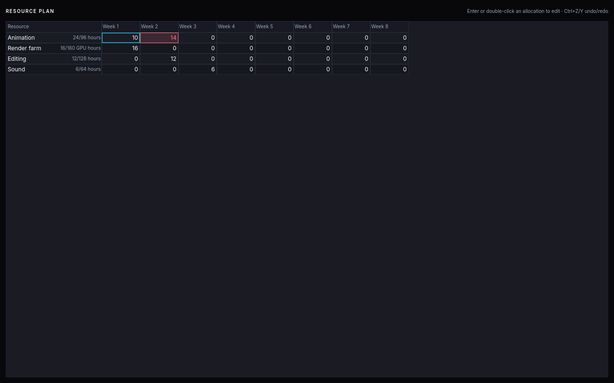
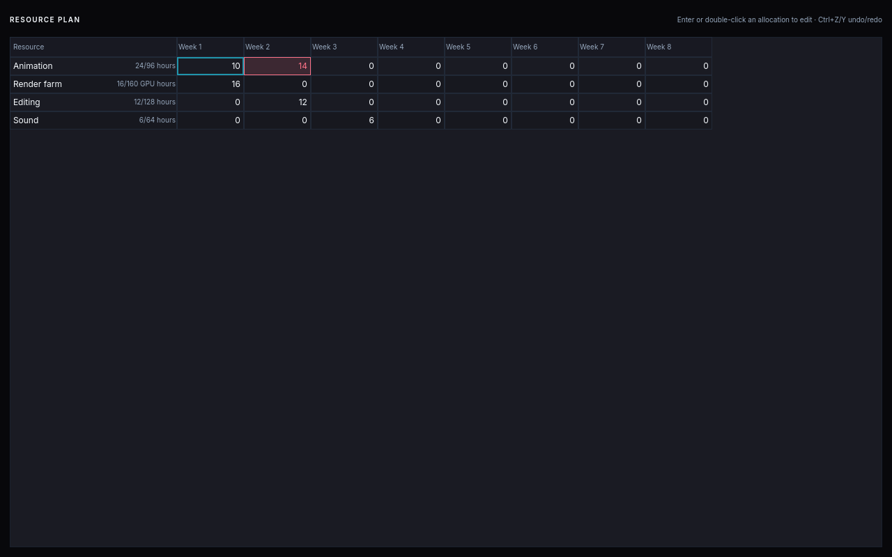

<!-- SPDX-License-Identifier: LGPL-3.0-or-later -->
# WP-032 resource table lane

**Scope:** DAT-20 ResourceTable only. EventLogView and DiffView remain in their
separate lanes. **Environment:** Qt 6.11.1, GCC 15.3, Linux, Debug/Ninja;
isolated worktree `/home/cabewse/work_SPaC3/QindaTK-wp032-resource` from
`0086eba`.

## Implemented behavior

- `ResourcePlanModel` holds stable resource IDs and bucket IDs, explicit
  resource units and per-bucket capacities, sparse allocations, resource
  totals, per-unit bucket totals, and per-cell/resource/unit-total conflicts.
- `requestAllocation()` and `setData()` use the same edit path. Over-capacity
  allocations remain representable and visibly marked; negative, non-finite,
  unknown-ID, and read-only edits reject without mutation. Each accepted cell
  edit changes allocation, totals, conflicts, revision, and history before
  publishing notifications. Local undo history is bounded to 256 operations.
- `ResourceTable` bounds visible cells to 4,096, virtualizes both axes, keeps
  selected and top-left viewport identities through source reordering, and
  exposes keyboard and accessible cell descriptions. Enter/F2 edits by stable
  IDs; Ctrl+Z/Y undo/redo.

## Verification

- `cmake --build build/wp032-resource` — passed with the configured default
  build parallelism.
- `ctest --test-dir build/wp032-resource -R
  '^tst_resource_plan_model$|^example_resource-table$' --output-on-failure` —
  2/2 passed.
- `QT_QPA_PLATFORM=offscreen QT_QUICK_BACKEND=software
  QML_IMPORT_PATH=build/wp032-resource/qml build/wp032-resource/tests/tst_qml
  -input tests/qml/tst_resource_table.qml` — 4 focused QML cases passed,
  including a 200×40 fixture that stays under 80 visible cells and preserves
  both viewport anchors and selected IDs while both axes reorder.
- `cmake --build build/wp032-resource --target all_qmllint` — passed. The
  repository reports its existing warnings across other QML files; no
  ResourceTable-specific warnings were present.
- The model fixture changes the Artist allocation from 9 hours to 3 against
  an 8-hour bucket capacity: plan usage changes from 14 to 8 hours and its
  over-allocation conflict clears. One undo restores 9 hours, the 14-hour
  total, and the conflict. The C++ test also checks per-unit bucket totals and
  one revision notification per allocation.

## Geometry and pixels

Compact dump:

```text
ResourceTable#resourceTable  0,32 1256x744
Rectangle#resourceCornerHeader  0,0 200x24
Rectangle#resourceRowHeader_animation  0,0 200x22
Item#resourceCell_animation_week-2  80,0 80x22
```

Comfortable dump:

```text
ResourceTable#resourceTable  0,39 1252x733
Rectangle#resourceCornerHeader  0,0 240x29
Rectangle#resourceRowHeader_animation  0,0 240x26
Item#resourceCell_animation_week-2  96,0 96x26
```

The compact and comfortable grabs were opened and inspected. Both show the
over-capacity Week 2 animation cell in the danger role, allocation values,
bucket labels, and visible resource usage/capacity totals.





## Remaining integration work

The root integration lane owns catalog regeneration, `docs/index.md`, and the
combined WP-032 ledger update. This evidence accepts only the isolated resource
lane, not the full WP-032 package.
