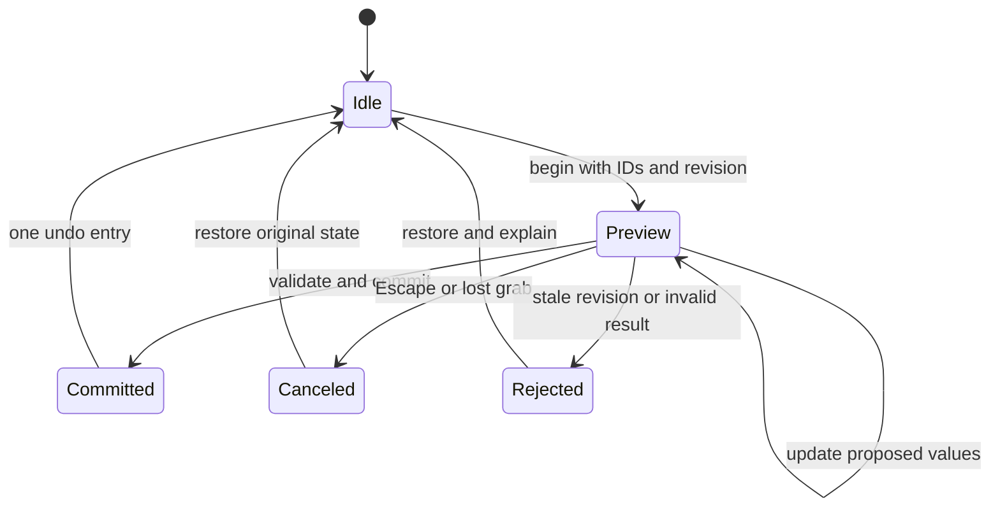

<!-- SPDX-License-Identifier: LGPL-3.0-or-later -->
# Hypothetical framework architecture and shared contracts

**PROPOSED — no API on this page is implemented by this documentation change.**
Names and signatures are design sketches for review. Existing type names retain
the behavior described in the [current reference](../current/00-type-index.md).

## Package structure

Keep `import QindaTK as Tk` as the public naming convention. Treat the categories
below as conceptual feature packs with optional build/backend dependencies;
they are not a decision to introduce conflicting QML import prefixes. Backend
availability should be discoverable before an application enables an optional
feature. Final packaging/export rules need an ADR when implementation begins.

| Layer | Proposed contents | Dependency direction |
| --- | --- | --- |
| Foundation | Existing theme/layout; units, IDs, interaction and model contracts | Qt and small reusable helpers |
| Application | Commands, document sessions, undo, selection, settings, jobs | Foundation; injected persistence/services |
| Common views | Controls, navigation, data views, charts, inspectors | Foundation/application; model adapters |
| Editing surfaces | Spatial canvas, rich documents, editable sheets, timelines | Common interaction contracts; domain interfaces |
| Domain packs | Graphics, Office, audio/MIDI, video/motion, notation, 3D | Editing surfaces and explicit backend capabilities |
| Adapters | Formats, rendering, devices, OS integration, collaboration | Implement interfaces; do not redefine core state |

Existing code remains useful independently of the application framework. A
simple utility should be able to use Button/Flex/Theme without loading a media
engine, document parser or collaboration client.

## Improvements to existing foundations

The named additions are not the entire backlog. Existing types also need
extensions and stronger guarantees; these should retain their current names
where the semantics remain compatible.

| Existing area | Proposed improvement | Completion evidence |
| --- | --- | --- |
| Flex | Implement true baseline alignment; document supported intrinsic sizing and wrapping behavior | Mixed fonts/editors align by baseline at all supported densities, with geometry and pixel checks |
| Grid | Document a deliberate supported grammar; evaluate auto-fill/fit, additional intrinsic sizing and responsive track policies when an app needs them | Reference fixtures prove placement/sizing, overflow and invalid-input behavior without implying full CSS support |
| All layout containers | Logical start/end, explicit layout direction and an adaptive narrow-window policy | RTL and long translated text remain navigable; changing density does not change document geometry |
| Box | Define whether rounded per-side borders are supported or remain a documented limitation | Consistent corners and clipping on GPU/software paths if support is added |
| Scroll | Define nested wheel/keyboard routing, scroll chaining, focus reveal and overscroll policy | Nested inspectors, grids and canvases route input to the intended scroll owner |
| Viewport | Add touch/trackpad policy, rotation, synchronized views and render-provider hooks through CanvasView | Cursor anchoring, inverse mapping and canceled gestures hold under transforms and mixed display scales |
| Theme/Density | Finish token coverage, high-contrast options, independent text scaling and sufficient hit targets | Every new role is derived/documented; visual and accessible workflows survive large text and high contrast |
| Theme scope | Evaluate optional scoped themes only if applications need simultaneous distinct chrome themes | Requires an explicit ownership/API decision; process-wide Tk.Theme cannot become per-window merely by changing a property |
| Menus/dialogs/popovers | Formalize bounds, focus return, dynamic-anchor tracking and overflow policy | Small windows, moved anchors, keyboard use and monitor changes preserve reachable content |
| All controls | Consistent reset, mixed/invalid/read-only/disabled semantics and documented user-versus-programmatic notifications | Shared behavior fixtures prevent binding loops and accidental domain edits |

Some of these are compatibility-sensitive. Preserve current behavior by default,
add capability/version notes, and write an ADR before changing established
layout or singleton ownership semantics.

## Shared data contracts

| Contract | Minimum fields / behavior | Ownership rule |
| --- | --- | --- |
| `EntityId` | Opaque stable identifier; never a visible row index | Domain model assigns it; identity survives sort/filter/view changes |
| `DocumentId` / `RevisionId` | Stable document identity and monotonic/snapshot revision | Document session and authoritative model own them |
| `CommandDescriptor` | id, text, icon, description, category, shortcut IDs, enabled, checked, disabledReason | Registry presents state derived from the active command context |
| `EditContext` | documentId, target IDs, base revision, user/tool origin, capabilities | Frozen at gesture start or deliberately rebased |
| `EditTransaction` | begin, update preview, validate, commit, cancel; merge key and undo label | One controller owns one gesture; domain validates the result |
| `SelectionState` | selected IDs/ranges, current item, anchor, model identity | Separate from visual delegates; model changes reconcile selection |
| `PropertyDescriptor` | key, type, unit, bounds, step, default, mixed, writable, validation, animation state | Model supplies semantics; editor chooses presentation |
| `AsyncRequest` | request ID, document/revision, cancellation, result/error, progress | Provider owns work; consumers reject stale completions |
| `AssetHandle` | stable asset ID, source URI, revision, metadata and capability set | Asset service owns load/cache/relink; view holds references |
| `RenderRequest` | document/revision, visible region, scale, device ratio, color/output context | Renderer may cache; view does not write content into render resources |
| `TimePosition` | exact integer/rational representation and explicit time domain | Engine/time mapper converts; UI pixels are derived |
| `ColorValue` | numeric components, alpha, color-space/profile reference, precision | Document model owns values; display conversion is explicit |
| `ValidationIssue` | stable code, severity, target/path, localized message and available remedies | Domain/service diagnoses; UI presents and routes remedies |

These are conceptual records, not declarations of current QML types. Prefer
typed C++ interfaces for high-volume and cross-thread boundaries; small QVariant
records remain suitable for low-volume UI metadata.

## One gesture, one reversible operation

A scrubbed number, dragged handle, range fill, audio fader and moved clip all use
this protocol. Preview may be computed locally or by a domain engine, but it
must have a defined cancellation path. The model decides whether preview writes
temporary state or supplies a separate preview overlay. Never silently commit
on lost focus unless the editor's documented interaction contract says so.

Keyboard stepping should use the same commands, with a deliberate merge policy.
Text input and IME preedit remain under the text editor until a semantic edit is
committed; a global shortcut must not consume ordinary text composition.

## Views and models

Virtualized delegates must be disposable. They retain no unique document edits,
selection, validation results or asynchronous job ownership. Bind data through
stable model indices/IDs and explicit roles; cancel subscriptions on recycling.
Expose sorting/filtering through proxy/adaptor interfaces without rearranging
the caller's storage as a side effect of a header click.

Every editable view defines navigation, selection granularity, keyboard focus,
commit/cancel behavior, clipboard schema, drag payload, and model reset/removal
behavior. A read-only view can reuse the same model interface and disable edit
capabilities explicitly.

## Coordinates, units and precision

Keep view/device pixels, document coordinates, physical units and time domains
distinct. The canvas transform maps document to viewport coordinates and has an
inverse. Device pixel ratio affects rasterization/hit tolerances, not document
geometry. Snapping tolerances are specified in screen space then converted to
the relevant document space.

Audio uses exact sample positions; video uses rational frame rates and frame
indices; musical views use ticks/beats through a tempo map. Conversions specify
rounding. A timeline ruler's labels are formatting, not the storage format.
Do not pass large exact positions through an unbounded JavaScript floating-point
calculation without defining precision limits and an integer/rational adapter.

## Theme and domain content

All new control chrome uses existing or newly derived Theme roles, including
focus, hover, selection, disabled state, sizes, hit targets and motion. A new
semantic role requires the property/table/preset/documentation changes specified
by repository instructions. Domain content, such as a red shape or a photo's
pixels, is document data and must retain its own colors across UI theme changes.

Add explicit palettes for categorical charts and selection overlays, with
non-color distinctions where meaning requires them. Professional color widgets
read a ColorContext; they do not guess a document color space from Theme.dark.

## Accessibility and internationalization

Each composite view defines role/name/state/value, keyboard commands, focus
entry/exit, announcements and accessible child identity. Virtualized offscreen
content still needs navigable semantics. Spatial editors offer a structured
selection/object alternative; timelines expose track/clip/time operations.

Test bidirectional text, right-to-left chrome, CJK input composition, grapheme
selection, locale-specific numbers, time zones and non-Latin fonts. Content
direction and timeline direction are explicit policies; mirroring an entire
editor blindly can reverse domain meaning. Reduced motion and scaled fonts must
work independently of density.

## Render and job lifecycle

GUI controllers issue versioned requests. Worker results return through queued
delivery; obsolete results are discarded after reload/close/revision change.
Render adapters declare GUI, worker and render-thread ownership plus device-loss
recovery. Long-running work exposes cancellation and partial-result policy.
Audio callbacks communicate through bounded queues/atomic snapshots and never
call QML, allocate unbounded work, or wait on GUI locks.

## Cross-window and persistence contracts

DockModel remains the panel-arrangement authority. A new window host would map
panel IDs to native windows and keep monitor placement separately from document
state. Restore paths clamp geometry to available screens and tolerate a missing
monitor, panel plugin or document backend.

Version all persisted schemas. Separate workspace preferences, application
settings, document content, asset references, recovery journals and engine
sessions. Store enough provenance to migrate or reject unsupported versions
without silently discarding content.

## Definition of a completed proposed component

Every proposal inherits these gates in addition to its local completion check:

1. Public API, data ownership, failure and cancellation paths are documented.
2. Keyboard and accessible operations reach the same semantic commands as pointer use.
3. Edits support undo/redo and survive save/reopen where they modify durable content.
4. Virtualization, stale results and object lifetime work on representative large inputs.
5. Compact/comfortable/touch, light/dark, scaled fonts and reduced motion are verified.
6. Stable objectNames and meaningful model/scene tests cover the behavior.
7. Geometry claims include preview dumps and reviewed screenshots; performance claims include measured hardware/workload details.
8. Source/docs/catalog/examples are updated together, respecting the 500 non-blank-line limit.

These are proposed release criteria, not claims about the current toolkit's
complete conformance. Implementation priorities are in the [roadmap](../roadmap.md).
