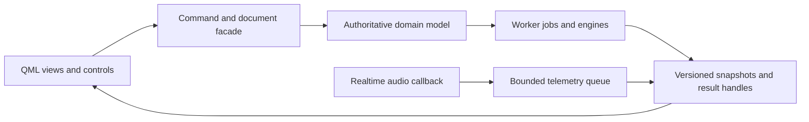

<!-- SPDX-License-Identifier: LGPL-3.0-or-later -->
# Toolkit, application model and engine boundaries

**Status: proposed architecture guidance.** QindaTK currently links Qt Core,
Gui, Qml, Quick, Svg and QuickPrivate; build tools also use QuickControls2.
See [CMake](../../../src/CMakeLists.txt). The integrations below are candidates,
not dependencies already supplied by this repository.

## Responsibility map

| Concern | Reusable toolkit responsibility | Application/domain engine responsibility |
| --- | --- | --- |
| Commands | IDs, labels, enabled/checked state, invocation and shortcuts | Meaning of delete, crop, calculate, render, route or save |
| Undo | Stack adapter, transaction/merge/cancel protocol, history UI | Reversible domain operations and snapshots/deltas |
| Documents | Session lifecycle, dirty state, close workflow, recent/recovery UI | Content schema, serialization, migration and validation |
| Selection | Stable IDs, ranges, current/anchor state and navigation adapters | What is selectable and how selections relate across model hierarchies |
| Rendering | Viewport, overlays, invalidation and resource ownership contract | Pixels, glyph layouts, meshes, frames and final export fidelity |
| Time | Typed positions, conversion interface and edit-space transforms | Transport clock, tempo/timecode rules and sample/frame scheduling |
| Tables | Virtualized views, delegates, edits, ranges and headers | Storage, query/sort/filter, schema, formulas and recalculation |
| Colors | Picker/gradient/curve UI and explicit display transform metadata | Color space conversion, tone mapping, profile/proof behavior |
| Assets | Browser, metadata panel, request/cancel/cache interfaces | Decode, media indexing, filesystem/network storage and relinking |
| Audio | Parameter controls, meters and timeline edits | Realtime DSP, device callbacks, recording and plugins |
| Jobs | Progress/cancel/retry/dependency UI and result identifiers | Work scheduling, actual conversion/render/export and output validation |
| Collaboration | Presence, comments, conflicts and revision affordances | Synchronization protocol, authorization, conflict semantics and durable log |

## Build, wrap or integrate

| Area | Recommendation | Evidence or investigation boundary |
| --- | --- | --- |
| Undo | Wrap Qt undo primitives behind a document-aware QML facade | [QUndoStack](https://doc.qt.io/qt-6/qundostack.html) supplies stack, macros, merge and clean-state primitives; domains still implement commands |
| Large tables/trees | Prototype QindaTK visuals and editing contracts over Qt Quick model views | [TableView](https://doc.qt.io/qt-6/qml-qtquick-tableview.html) supplies model-driven virtualization and edit hooks; audit the project's Qt 6.8 minimum before choosing newer APIs |
| Accessibility | Extend native Qt semantics for composite editors and validate on real assistive technology | [Accessible](https://doc.qt.io/qt-6/qml-qtquick-accessible.html) provides roles, names, actions and states; declaring a role alone does not prove usable editing |
| Text documents | Evaluate Qt text primitives for a limited rich-text editor, then evaluate a dedicated layout engine for publishing | Pagination, advanced typesetting and complex format roundtrips require fixture-based prototypes before backend selection |
| PDF | Integrate a maintained renderer/editor backend through a page/text/annotation adapter | Rendering, writing, OCR, signatures and redaction may need different capabilities; do not advertise edit/export fidelity from rendering alone |
| Media | Integrate decode/encode and image-provider backends behind asset/frame services | Verify target formats, hardware paths, timing, licensing and error behavior against chosen backend documentation when implementing |
| DAW engine | Build or integrate a dedicated audio/session layer with GUI snapshots | No GUI object or unbounded allocation/lock may run in the realtime callback path |
| Charts | Evaluate a chart backend or add renderer primitives behind an explicit chart model | Current Graph is useful telemetry infrastructure; it is not a general chart model |
| 3D | Embed an external or Qt-compatible scene renderer through a lifecycle adapter | Toolkit owns controls and overlays; renderer owns device resources, scene evaluation and picking |
| Professional color | Integrate a profile/transform engine through ColorContext | Theme's QColor values describe chrome; document values need declared spaces and numeric precision |
| File interchange | Add independent format adapters and test corpora | Opening one file does not prove edit/save/roundtrip compatibility |

Recommendations are based on the observed boundary, not a completed comparative
evaluation of third-party libraries. Avoid committing to a backend until a small
application exercises its hardest required operation and failure mode.

## Threading and ownership contract

QML and toolkit objects remain on the GUI thread. Background services return
immutable data or handles tagged with document and revision IDs. The GUI rejects
obsolete results after a document changes or closes. GPU resources cross only a
defined render-thread interface, with explicit ownership and invalidation.

The audio engine publishes bounded telemetry at a UI-appropriate rate. Graph,
Meter and proposed audio displays consume snapshots; they never receive a raw
audio callback. UI parameter gestures send commands/control messages through a
bounded adapter with domain-defined timing.

## Format compatibility is its own workstream

For each proposed format adapter, define separate levels: **recognize metadata**,
**render**, **import editable content**, **export**, and **roundtrip**. Preserve
unsupported data where possible and report loss explicitly. Include malformed,
large, linked-asset, multilingual, versioned and partially supported documents
in the fixture corpus.

Illustrative families include office documents/workbooks/slides, PDF, layered
raster/vector files, MIDI/notation, edit interchange and native sessions. Those
names in a requirements list are not a supported-format list. Backends and
licensing decisions are outside this audit and should be reviewed against the
actual chosen implementation before distribution.

## Architectural mistakes to prevent

| Temptation | Resulting problem | Contract that prevents it |
| --- | --- | --- |
| Store edits only in delegate properties | Sorting/recycling loses data or edits the wrong row | Stable IDs and an authoritative model |
| Record every slider movement as an undo step | One drag floods history and may never cancel cleanly | Begin/update/commit/cancel gesture transaction |
| Save dock JSON as the application session | Documents, assets and engine state disappear | Distinct workspace and document/session storage |
| Feed all samples/pixels into QML arrays | Allocations and conversions stall interaction | Tiled/leveled providers and bounded snapshots |
| Use pixel coordinates as document state | Zoom/density changes alter meaning | Explicit coordinate spaces and typed units |
| Reuse float seconds for every time domain | Long-session rounding and mismatched edits | Rational frame/sample positions and tempo conversions |
| Treat Theme colors as output colors | Proofing and exported content disagree | Document ColorContext and output transform |
| Put plugin code inside a control | Lifecycle failures spread through every view | Versioned extension interface and isolation policy |

The [hypothetical architecture](../proposed/00-architecture.md) describes these
contracts in more detail, and the [roadmap](../roadmap.md) defines proof points.
