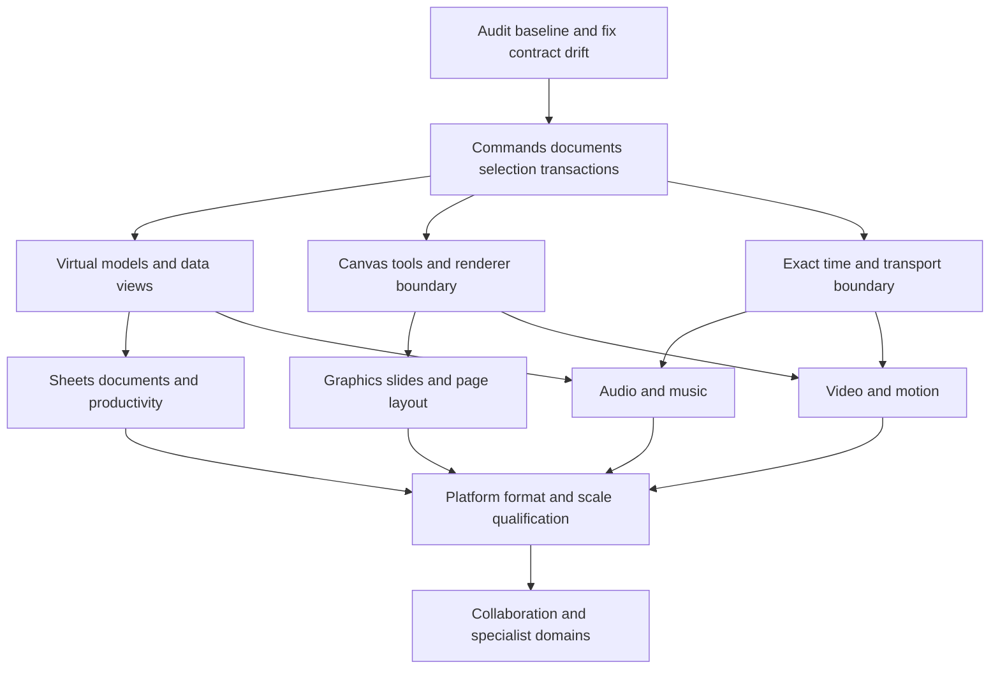

<!-- SPDX-License-Identifier: LGPL-3.0-or-later -->
# Implementation roadmap and acceptance gates

For the subsequent request to implement the **complete** proposal, use the
[detailed Sol execution plan](implementation/README.md) and
[handoff prompt](implementation/sol-handoff.md). That program covers all 212
proposals, including the advanced items described as optional below, in 84 work
packages with explicit ownership, dependencies and acceptance evidence. This
page remains the original strategic overview.

**PROPOSED — dependency sequence, not a delivery schedule.** The 212 entries in
the [addendum](proposed/10-proposal-index.md) are a requirements/design inventory.
Several can share one implementation, wrap Qt facilities, or remain application
adapters. Building all of them is not a prerequisite for shipping one app.

## Choose the first product by its hardest edit

| First product | First domain proof | Reuse immediately | Main engine uncertainty |
| --- | --- | --- | --- |
| Image/vector/slide editor | Select, transform and undo an object, then save/reopen | Viewport, StylusHandler, property controls, docking | Render/document model and editable format fidelity |
| Spreadsheet/data app | Edit/paste a range while scrolling large data, then recalculate/save | DataTable for readouts, ordinary inputs and shell | Workbook/model/calc and range semantics |
| Word/page-layout app | Edit across a page break with objects/styles, then export | AppWindow, Ruler, Viewport and dialogs | Text layout, pagination and structured document fidelity |
| DAW | Move/trim/automate a clip while an engine clock advances | Waveform, TimeRuler, Meter as generic previews | Audio graph, device/clock timing and plugins |
| NLE/motion app | Frame-accurate trim/keyframe edit with reproducible render | DockHost, Filmstrip, Thumbnail, viewport chrome | Codecs, rational time, compositor and cache |

The recommended shared investment is R0–R1 below. Then select a real pilot and
build only its necessary domain path, extracting reusable behavior as it proves
useful in a second application.

## Dependency map

Accessibility, localization, failure recovery and measurements begin with R1 and
remain gates in every path. “Qualification” adds complete platform/workflow
coverage; it does not postpone basic quality until the end.

## R0 — establish an accurate supported baseline

**Deliverables:** triaged [F01–F09](reports/04-source-audit.md), current public API
inventory, documented internal exports, regenerated catalog, and an explicit Qt
and platform support statement. Resolve no-op/misleading APIs before new apps
depend on them. Add focused regressions only for demonstrated behavior defects.

**Exit gate:** catalog/reflection omissions are covered or explicitly documented;
supported components instantiate; targeted interaction/geometry fixes have
passing tests and inspected images. Record actual test results and environments.

## R1 — common application behavior

**Deliverables:** APP-01–08 commands/context/shortcuts/undo/transactions/selection/
document sessions/manager, APP-10 property binding, APP-18 recovery, and the
PLT-06/08 accessibility/focus contracts. Add APP-13 jobs when the pilot first
needs asynchronous work. Build a minimal app with two documents and two views.

**Exit gate:** all invocation paths resolve to the same operation; one drag is
one undo step; Escape and lost grabs cancel; failed saving prevents destructive
close; recovery reopens a valid revision. Selection survives sort/model changes.
Keyboard and assistive actions exercise the same semantic commands.

**Decision to settle:** ownership of command contexts, model revision policy,
undo memory budget, save atomicity, and recovery retention. Preserve user-facing
behavior in tests rather than exposing implementation helpers as API.

## R2 — scalable data and reusable inspector behavior

**Deliverables:** DAT-01–06 virtual list/tree/grid, headers and range overlays;
CTL-12–16 inspector/mixed/unit/expression/vector editors as required by the pilot;
APP-14–16 asset/clipboard/drag services. Expression support can wait when the
pilot only needs unit-aware values. Add ChartView/Axis/Series after a real
analytical display establishes its needs.

**Exit gate:** standard model updates work without whole-document JS copies;
range paste validates and undoes correctly; lazy tree expansion survives reset;
recycled delegates release subscriptions and reject stale data. Large tests
measure delegates, frame timing and memory rather than relying on comments.

## R3 — spatial authoring framework

**Deliverables:** CAN-01–08 canvas, tools, hit testing, snapping, selection,
transform handles, guides and artboards; CAN-09 layer tree; CAN-10–12 masks/color
as required. Use APP-10 property binding to synchronize inspector and handles.

**Exit gate:** select/move/resize/rotate/group, cancel, undo and save/reopen in a
small real object document. Pen gestures have exactly one lifecycle. Multiple
views show the same edit. Tiled rendering does bounded work for visible content.

**Decision to settle:** object geometry/hit interfaces, screen versus document
units, paint/selection ownership, and renderer/resource thread boundaries.

## R4 — prove domain packs with complete vertical slices

| Slice | Minimum new pieces | Required engine proof | Completion scenario |
| --- | --- | --- | --- |
| Word/page layout | OFF-01/02 rich text/document, styles, page navigation/setup, review/print as needed | Paragraph layout, pagination and document serializer | Edit styled text across pages with an anchored object; undo, save/reopen and compare exported pages |
| Spreadsheet | OFF-14–18 sheet/formula/tabs/formatting/validation and DAT grid | Known subset of formulas, dependency recalculation and workbook storage | Enter formulas, fill/paste a range, insert rows, recalculate, undo and reopen with identical references/results |
| Slides | OFF-19–23 canvas/sorter/masters/animation/presenter | Object serialization, inherited layouts and playback/output | Create/reorder slides, change a master, animate an object and present notes/audience on separate views |
| Graphics | Canvas tools, PathEditor or brush/layer pipeline, ColorContext | Actual vector or raster editing, not only overlay drawing | Transform and mask/paint content, undo and export with declared color behavior |
| DAW | AUD-01–10 time/transport/timeline plus mixer/automation subset | Deterministic session clock first, real audio later | Record/import, trim/comp, automate a parameter, save/reopen and render a verified audio result |
| NLE | Shared timeline/time plus VID monitors/trim/bin and queue | Known decode/composite/encode path and exact frame identity | Assemble, trim, relink a missing asset and export a sequence with expected boundary frames |
| Motion | KeyframeTimeline, CurveEditor and CompositionView | Curve evaluation and compositor | Animate transforms/effects, edit tangents, undo and compare sampled output frames |

A mocked engine verifies GUI/model contracts but cannot qualify real recording,
playback latency, render quality, export fidelity or format compatibility. Keep
those results separate in release notes.

## R5 — platform, backend and release qualification

**Deliverables:** chosen PLT window/file/print/device/render/format adapters,
backend capability discovery, install/consumer examples, version policy and
format fixture corpus. Exercise private Qt API dependencies against supported
versions. Native detachable panels follow WindowHost, not a rename of existing
DockFloating.

**Exit gate:** release packages import/link in a clean consumer application;
supported OS/GPU/input paths pass named workflows; missing optional backends have
useful fallback behavior. Publish a capability matrix per format operation and
platform instead of claiming universal interoperability.

## R6 — optional advanced domains

Add collaboration only after commands, stable identity, model revisions and
recovery are reliable. Add notation, spectral/pitch tools, node compositing,
rigging/3D, CAD/GIS or scientific views when an application supplies a domain
model and measurable requirements. Backend complexity dominates these efforts;
widget count is not an effort estimate.

## Proposed scale fixtures

These are **future benchmark inputs**, not measured current capacity or universal
minimum requirements. Record machine, backend, build type, display size/density,
dataset generator and operations before comparing results.

| Fixture | Suggested initial size | Inspect |
| --- | --- | --- |
| Editable table | 100,000 rows × 100 columns from a lazy model | Visible delegate bounds, edit latency, two-axis scroll, memory growth and range operations |
| Tree/catalog | 100,000 nodes/assets with lazy children/previews | Expansion/filter costs, cancellation, selection identity and decoder concurrency |
| Spatial document | 10,000 objects plus a large tiled image | Hit testing, transforms, visible tile work, undo memory and overview rendering |
| Timeline | 100 tracks / 10,000 clips and a long duration | Exact time mapping, visible-item bounds, scrubbing, trim/selection and auto-scroll |
| Rich document | 500 pages with tables/images and mixed scripts | Repagination locality, cursor mapping, text selection and print equivalence |
| Graph/telemetry | Many bounded histories at several update rates | GUI delivery batching, ring memory, GPU/software output and missing-sample handling |
| Multi-window | Several views with mixed display scales and monitor removal | Focus, restore, popup placement, render resource lifecycle and reachable geometry |

Measure median/p95/p99 interaction latency, frame duration, peak/steady memory,
background work and cancellation latency. Choose thresholds for the actual
product/hardware; do not substitute a nominal frame-rate slogan for measurements.
Realtime audio deadlines are engine/device contracts and must be measured
independently of GUI frame rate.

## Release checklist

- Documented public/optional/internal API and compatible version range.
- Commands/undo/cancel, save/recovery, stale results and deletion/reset tested.
- Keyboard/IME/screen-reader workflows and localized/scaled layouts verified.
- Geometry dumps and reviewed screenshots for visual/layout changes.
- Domain fixtures prove calculations, times, formats and output behavior.
- Engine/platform failures are visible and recoverable.
- Examples, human docs and machine catalog match the shipped implementation.

All builds must preserve the user's configured system MAKEOPTS, read from the
system when needed. Do not reduce configured parallelism in command flags,
environment variables, presets or job pools. No build was performed for this
documentation-only task.
